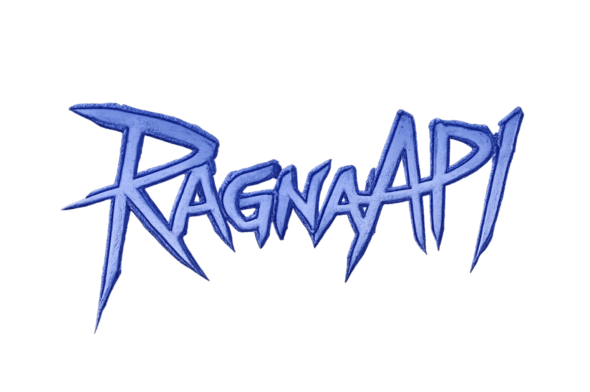

<p align="center">
  
</p>

# RagnaAPI

RagnaAPI is a public **read-only** REST API (and website) for **Ragnarok Online** data (monsters and items, organized by different game “eras”).

- Website: `https://ragnapi.com`
- API base URL: `https://ragnapi.com/api`

## Endpoints (v1)

All endpoints below are **GET** and return **JSON**.

### Monsters

- `GET /api/v1/old-times/monsters/:monsterId`
- `GET /api/v1/re-newal/monsters/:monsterId`
- `GET /api/v1/re-start/monsters/:monsterId`

### Items

- `GET /api/v1/old-times/items/:itemId`
- `GET /api/v1/re-newal/items/:itemId`

### Catalog lookups (awaiting verified datasets)

- `GET /api/v1/:era/skills/:id`
- `GET /api/v1/:era/maps/:id`
- `GET /api/v1/:era/vendors/:id` (NPC shops)
- `GET /api/v1/re-start/items/:id`

Supported era identifiers: `old-times`, `re-newal`, `re-start`. These new routes
return `503 DATASET_UNAVAILABLE` until a separately reviewed dataset is activated.
Their normalized response is `{ data, dataset }`. Existing lookups above retain
their original contracts. No real catalog data is bundled or loaded by this change.
See [coverage, sources, contract and import workflow](doc/data-catalog.md),
including the read-only `catalog:integrity` diagnostic for NPC shop/map/item
references across supplied snapshots. Missing references in partial catalogs are
reported as warnings; this does not activate or populate any route.

### Health

- `GET /api/health/mongo` → `{ isConnected, connectCalls }`

### Examples

```bash
curl https://ragnapi.com/api/v1/old-times/monsters/1001
curl https://ragnapi.com/api/v1/re-newal/items/501
```

## How it works (in this repository)

An optional read-only MCP stdio adapter exposes these existing lookups as
`ragna_get_monster` and `ragna_get_item`. Run `node mcp/server.mjs` with Node.js 22+
and configure your MCP client using [the tool contract and setup](doc/mcp.md).
It adds no dependencies; dataset provenance, version and completeness remain unverified.

This project uses **Next.js (Pages Router)** to serve:

- website pages (`src/pages/*.tsx`)
- API routes (`src/pages/api/**`)

The API queries a MongoDB instance configured via environment variable and reads documents from:

- databases: `old-times`, `re-newal`, `re-start`
- collections: `monsters`, `items`

Lookup IDs are numeric (`monster_id` for monsters and `id` for items).

## Stack

- Next.js + React + TypeScript
- MongoDB (official driver)
- Typical deployment: Vercel (with CDN caching)

## Caching and responsible use

API routes set CDN-friendly cache headers via `Cache-Control` (e.g. Vercel). Still:

- cache responses client-side whenever possible
- avoid aggressive polling / unnecessary scraping

## Running locally

### Requirements

- Node.js compatible with the Next.js version in `package.json`
- Yarn (v1)
- A MongoDB instance containing the expected databases/collections

### Install

```bash
yarn install
```

### Environment variables

Create a `.env.local` file at the repo root:

```bash
MONGODB="mongodb+srv://<user>:<pass>@<host>/<db>?retryWrites=true&w=majority"
```

Optional (analytics):

- `NEXT_PUBLIC_GA_ID` (GA4 Measurement ID on the client)
- `GA4_API_SECRET` (Measurement Protocol secret for server-side events from `/api/**`)
- `GA4_MEASUREMENT_ID` (server-side alternative to `NEXT_PUBLIC_GA_ID`)
- `NEXT_PUBLIC_GA_DEBUG=true` / `GA4_DEBUG=true`

### Dev

```bash
yarn dev
```

Open `http://localhost:3000`.

### Build / production

```bash
yarn build
yarn start
```

## Contributing

Contributions are welcome.

- Setup guide: `doc/setup.md`
- Engineering guidelines: `doc/guideline.md`
- Decision log: `doc/decisions.md`

## Credits / data sources

This project references community sources (e.g. iRO Wiki). See `https://ragnapi.com/about` for more context.

## License

This repository does not include a `LICENSE` file yet. If you plan to reuse/redistribute the code, please open an issue/PR to define and add a license.
